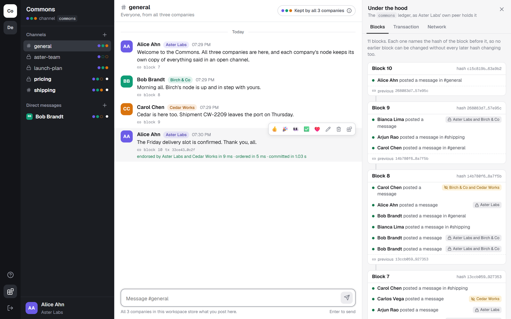
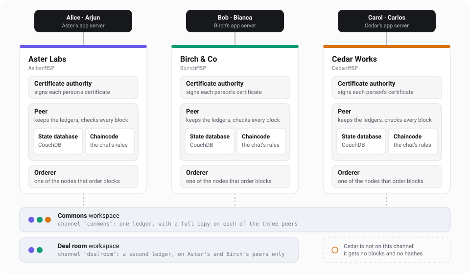
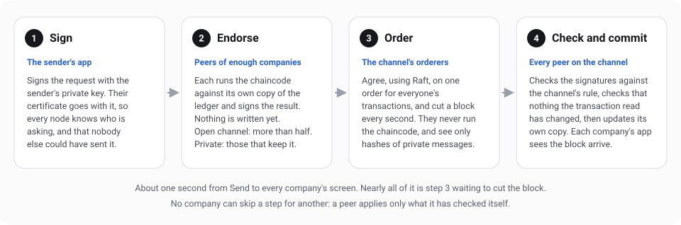
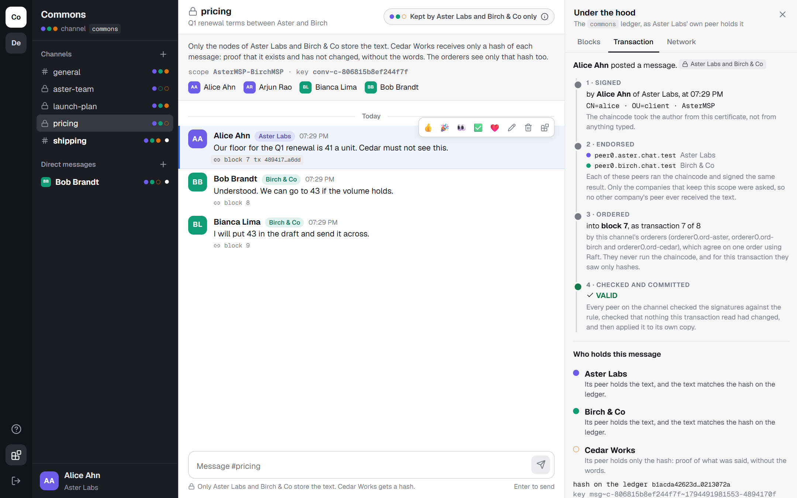
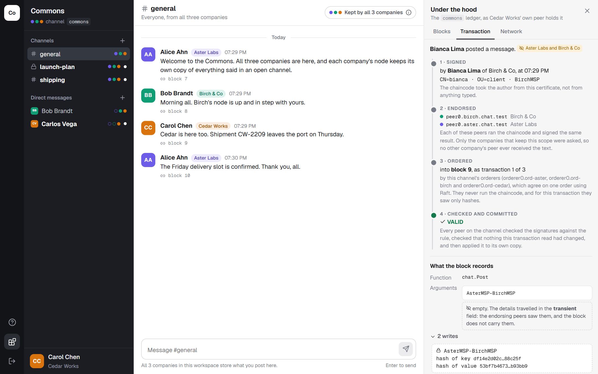
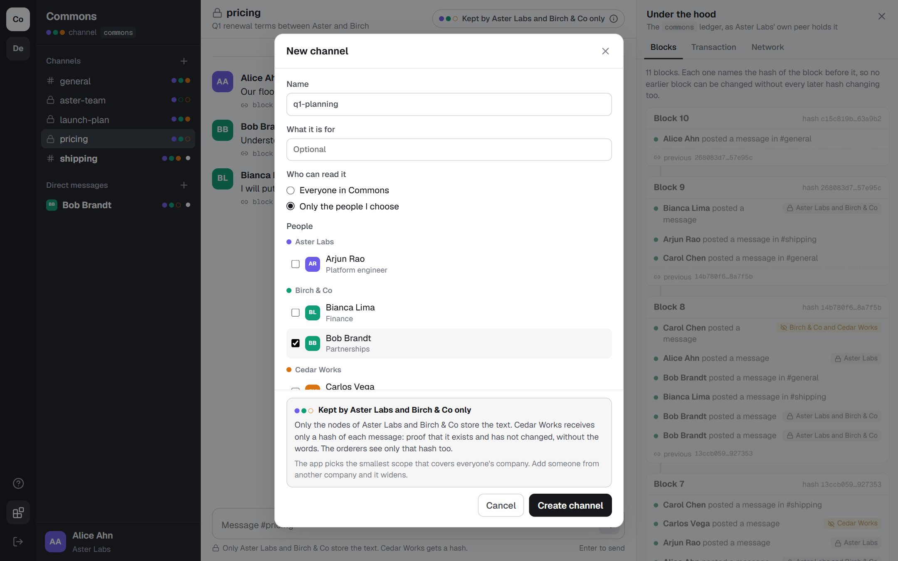
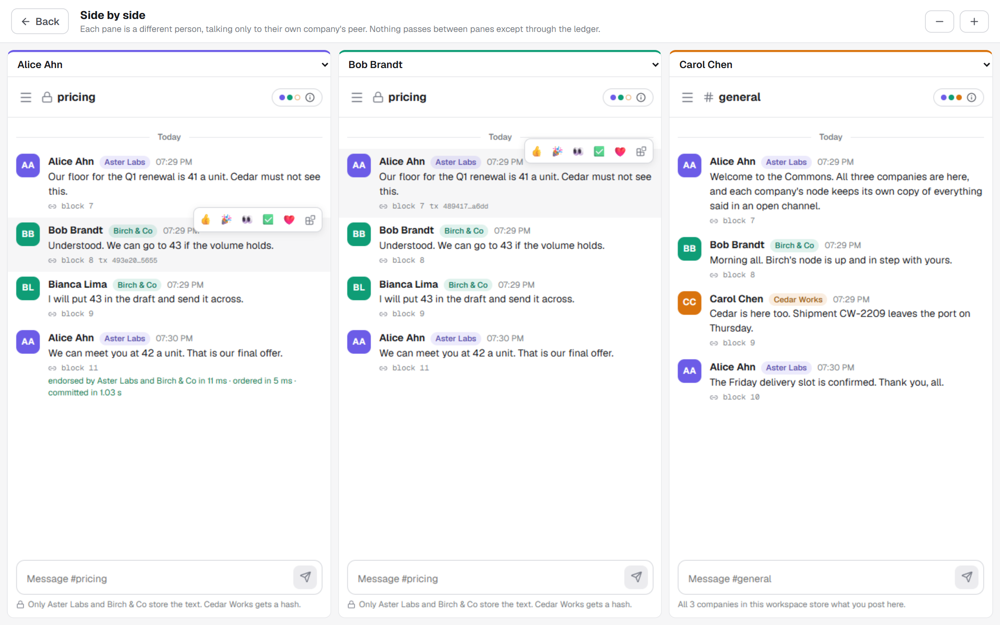
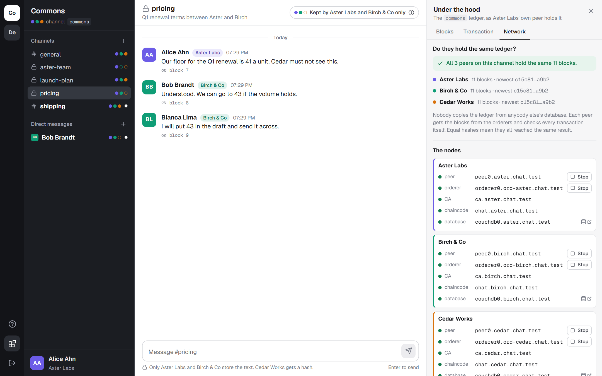

# Fabric Chat

A Slack-style team chat where the database is a Hyperledger Fabric 2.5 ledger. Three made-up companies each run their own nodes, and every message is a transaction on the ledger they share. It was built to explain Fabric: every message can be followed through the network, and the app shows which companies' nodes hold its text.

Everything in it is test data: the companies, the people, the certificates and the messages.



## Run it

You need Docker Desktop (with the WSL 2 backend on Windows) and Node 22.13 or newer. Nothing else: no Go, and no Fabric tools on the machine. Everything that needs them runs in containers.

```bash
npm install
```

```bash
npm run net:up
```

```bash
npm run dev
```

Then open http://localhost:4700 and choose who you are.

`net:up` takes under a minute once the images are downloaded (about 1.7 GB the first time). It starts 16 containers, creates two channels, deploys the chaincode, enrols six people and writes a few conversations.

| Command | What it does |
| --- | --- |
| `npm run net:status` | Which containers run, and how many blocks each company's peer holds |
| `npm run net:stop` / `net:start` | Pause and resume, keeping the ledgers |
| `npm run net:down` | Remove everything: containers, ledgers, certificates |
| `npm run net:chaincode` | Rebuild and restart the chaincode after changing the Go code |
| `npm test` | The chaincode's unit tests, then an end-to-end check against the running network |

`npm test` writes a few test channels to the ledger. A ledger cannot forget them, so run `npm run net:down` and `npm run net:up` afterwards if you want a clean one.

After `net:down` and `net:up`, stop `npm run dev` and start it again. The app server keeps the certificates in memory, and a rebuilt network has new ones.

## What each thing is on Fabric

| In the app | On Fabric |
| --- | --- |
| A company, such as Aster Labs | An organisation. It runs its own peer, its own orderer and its own certificate authority (CA). |
| A person, such as Alice | A certificate her company's CA signed, and the private key that goes with it. Every message she sends is signed with that key. |
| A workspace | A channel: one ledger, held by the companies on it and by nobody else. |
| An open #channel | Records in the channel's shared state. Every company on the channel stores them, and they appear in the blocks in the clear. |
| A private channel or direct message | Records in a private data collection. Only the companies it names store the text. Everyone else on the channel gets a hash. |
| Pressing Send | A transaction: endorsed by peers, ordered into a block, then checked and applied by every peer on the channel. |
| The rules: who may post, edit or join | Chaincode. The same program runs on every company's peer, and a change counts only if they reach the same result. |
| A message arriving | A block event. Each company's app watches the blocks its own peer commits. Nothing travels between companies except through the ledger. |
| A message's edit history | The blockchain itself. Each earlier version sits in an earlier block, and each block names the hash of the one before it. |

## The network



- **Three companies**, each with one peer (and its CouchDB state database), one orderer, one CA and one copy of the chaincode.
- **Two channels.** `commons` is on all three peers. `dealroom` is on Aster's and Birch's peers only, and only their two orderers order it, because an orderer sees every transaction it orders.
- **Ordering is Raft**, one orderer per company. Two of the three must be running for `commons` to take a transaction.
- **The rule for a change** on a channel is "more than half of its companies must endorse it". No single company can write to the shared ledger alone.

All of it comes from [network.json](network.json). Add a company or a person there and run `npm run net:down` then `npm run net:up`.

## What happens when you press Send



In the app, click the small "block" link under any message. The panel on the right shows these four steps for that message, with the real names: whose certificate signed it, which peers endorsed it, which block it is in, and what every peer decided about it.

## How private is a conversation?

Every conversation shows three dots: one per company in the workspace. A filled dot means that company's node stores the text. A hollow dot means it stores only hashes.

| Kind | Aster's peer | Birch's peer | Cedar's peer | Orderers | What an outside company still sees |
| --- | --- | --- | --- | --- | --- |
| Open channel, such as #general | text | text | text | text, in the block | Nothing is outside: all three are in it |
| Private, two companies, such as #pricing | text | text | hash only | hash only | That Alice wrote something, when, and in which collection |
| Private, one company, such as #aster-team | text | hash only | hash only | hash only | The same |
| A separate workspace, such as Deal room | text | text | nothing | text, but only Aster's and Birch's orderers | Nothing at all, not even that the channel exists |



The app chooses the scope for you: the smallest one that covers the company of everyone in the conversation. Add someone from a third company and the conversation can no longer be private from that company.

Three things are worth knowing before promising anyone privacy on Fabric:

1. **Privacy is between companies, not between people.** Whoever runs a company's peer can read everything that peer stores. The chaincode stops Arjun from reading a conversation Alice did not add him to, but Aster's administrator could open the database. Secrecy between colleagues would need the text to be encrypted before it is sent.
2. **A hash proves, but also leaks a little.** Cedar cannot read an Aster and Birch message, yet it holds the hash that proves what was said, which settles any later dispute between the two. It also sees who sent each private transaction and when.
3. **"Members only" is not "private" when all companies are involved.** A members-only channel with people from all three companies is kept in the shared state, in the clear. The app marks such channels with a warning.

This is the same #pricing message as Carol of Cedar Works can see it. Her peer received the transaction in a block like everyone else's: she can see that Alice sent something, and when, and hashes where the text would be.



The app tells you where a conversation will be kept before you create it:



## Ten minutes with it



1. **Open three people side by side.** The button is on the first screen. Send a message as Alice in #general and watch it reach Bob and Carol about a second later.
2. **Follow a message.** Click the "block" link under it. Read the four steps, then scroll down to "What the block records".
3. **Go private.** As Alice, post in #pricing. Bob receives it. Carol has no #pricing at all, but her ledger panel shows a transaction marked "Aster Labs and Birch & Co". Click it as Carol: she sees who sent it and when, and hashes where the text would be.
4. **Edit, then delete.** In #general, the old versions stay under "Every version, still on the ledger". In #pricing, delete purges the text from both peers. Only the hashes in the old blocks remain.
5. **Start a channel.** Tick people from different companies and watch "Kept by" change before you create it.
6. **Add a person.** On the first screen, "Add a person" asks that company's CA to sign a new certificate. The new person can post at once.
7. **Take a node away.** In the ledger panel, under Network, stop Cedar's peer and post in #general: it still commits, because two of three companies can endorse. Start it again and its block count catches up. Stop Birch's peer and post in #pricing: refused, because both companies that keep it must endorse. Stop two orderers and nothing commits.

   
8. **Switch to the Deal room** (the "De" tile). Under Network, Cedar is listed as holding nothing.
9. **Look inside each company's database.** Open http://localhost:45984/_utils (Aster), http://localhost:45985/_utils (Birch) and http://localhost:45986/_utils (Cedar). The user is `admin` and the password is in `.generated/secrets.json`. Aster has a database named `commons_chat$$p$aster$m$s$p-$birch$m$s$p` holding the private messages. Cedar has only `commons_chat$$h…`, the hashes, and no `dealroom` databases at all.

## From one laptop to many companies

This demo runs every company on one machine. The next step is each company running its own copy on its own server, adding its own people and connecting to other companies when it chooses to. [docs/many-companies.md](docs/many-companies.md) is a short guide to that: what each company runs, how two companies connect, what has to change in this code, and which repositories to make. Its main claims were tested with the scripts in [docs/lab](docs/lab).

## How it is built

```
network.json          the companies, people and workspaces
network/              turns network.json into a running Fabric network
  generate.mjs        writes the certificate, channel and Docker Compose files into .generated/
  net.mjs             up, down, status, stop, start: it only calls Docker
  scripts/            what runs inside the containers: channels, chaincode, enrolment
chaincode/chat/       the chat's rules, in Go
server/               the app server: Fabric Gateway client, block decoder, HTTP API
web/                  the pages: React
docs/                 the figures on this page
```

### The chaincode

One contract, `chat`, in [chaincode/chat](chaincode/chat). Every function that writes takes a scope and one JSON document, and refuses with a coded error such as `CHAT_NOT_MEMBER`.

| Function | What it does |
| --- | --- |
| `Join`, `Directory`, `Whoami` | The workspace's directory of people. An ID such as `alice@AsterMSP` is read from the caller's certificate, never from an argument. |
| `CreateConversation`, `AddMembers`, `Overview` | Channels and direct messages. Everyone in a conversation must work at a company that keeps its scope. |
| `Post`, `Messages`, `Edit`, `Delete`, `React` | Messages. Only the author may edit or delete. Delete blanks a public message and purges a private one. |
| `History` | Every version a public message has had. |
| `Inspect` | What the peer running it holds for one key: the record, or only its hash. This is what "Who holds this message" asks each company's peer. |

Records are kept under readable keys: `profile~alice@AsterMSP`, `conv~general`, `msg~general~1794489506634-ee38f29a`, `react~general~<message>~tada~bob@BirchMSP`.

### The app server

[server/fabric.ts](server/fabric.ts) talks to Fabric through the Gateway service each 2.5 peer runs. A read asks the person's own company's peer. A write goes through `endorse`, `submit` and `getStatus`, and the time each took is shown under the message.

[server/ledger.ts](server/ledger.ts) follows each peer's blocks from block 0, and [server/decode.ts](server/decode.ts) unpacks them: the signer, the endorsers, the reads and writes, the validation result. The ledger panel is drawn from that, and so is the live update of the chat.

## From the test-network tutorial to this network

The Fabric tutorial at [Using the Fabric test network](https://hyperledger-fabric.readthedocs.io/en/release-2.5/test_network.html) does these steps one at a time with `network.sh`. Here `npm run net:up` does the same steps for three companies, and prints them as it goes.

| Tutorial | Here | The Fabric tool behind it |
| --- | --- | --- |
| Before you begin: install samples, binaries and images | Nothing to install: the tools run in the `fabric-tools` container | |
| `./network.sh up` | Steps 1, 2 and 4 | `cryptogen`, then `docker compose up` |
| `./network.sh createChannel` | Step 5, once per channel | `configtxgen` for the first block, `osnadmin channel join` for each orderer, `peer channel join` for each peer |
| `./network.sh deployCC` | Steps 3 and 6 | `peer lifecycle chaincode` `install`, `approveformyorg`, `commit` |
| "Interacting with the network" with the `peer` command | The app, through the Gateway | `@hyperledger/fabric-gateway` |
| "Bring up the network with Certificate Authorities" | Step 7: each company's CA enrols its people | `fabric-ca-client register` and `enroll` |

What is different from the tutorial's network: three companies instead of two, an orderer per company instead of one shared orderer, two channels with different members, private data collections, and the chaincode running as a service.

## If you have used Fabric 1.4

Much of what is written about Fabric describes version 1.4. These are the places where 2.5 works differently, and what this project does in each.

| | Fabric 1.4 | Fabric 2.5, as used here |
| --- | --- | --- |
| Starting a channel | An orderer system channel and a consortium first. Then a channel transaction, then an anchor-peer update per company. | No system channel. One first block per channel holds everything, anchor peers included. Each orderer is handed it with `osnadmin channel join`. |
| Deploying chaincode | `install`, then one company runs `instantiate` and sets the endorsement policy for everyone. | Each company installs and approves for itself. It is committed only once more than half have approved the same definition. |
| Running chaincode | The peer builds a Docker image and starts it, which needs the Docker socket inside the peer. | Chaincode as a service: an image built once, one container per company, and the peer connects to it. No Docker socket in the peer. |
| Sending a transaction | The app picks the endorsing peers, collects their answers and sends them to an orderer. | The app talks only to its own peer's Gateway, which finds the endorsers and the orderer itself. |
| Finding a transaction's block | A query to the peer afterwards, then decoding the block by hand. | The app follows block events and decodes them as they arrive. |
| Private data | Collections that every company must list up front. | The same, plus a collection per company that Fabric provides for free, and purge (new in 2.5). |
| Endorsement rule | One rule per chaincode. | A default for the channel, and a separate rule for each private collection. |
| Go chaincode library | `fabric/core/chaincode/shim` | `fabric-contract-api-go/v2` |

## Things this build taught

1. **CouchDB hands JSON back with its keys in alphabetical order.** A record written with keys in another order comes back as different bytes, so the hash of what a peer holds no longer equals the hash on the ledger. The chaincode writes every record with sorted keys ([ledger.go](chaincode/chat/ledger.go), `canonical`).
2. **Private details travel in the transient field, never as arguments.** Arguments are recorded in the block for every company. The chaincode refuses a private call that carries its details as an argument.
3. **A hash of a short message can be guessed.** Everyone on the channel sees the hash of each private record, and could hash "yes" and "no" to compare. Every private record carries a random salt.
4. **A private transaction may not search and write.** Fabric refuses a transaction that runs a range query on a collection and also writes to it. Reads of one key are fine. So a private delete is told which reactions to clear instead of looking them up.
5. **Avoid records that everyone updates.** Two transactions that read the same record and land in the same block cannot both win. A conversation's "last message" pointer is overwritten without being read, and each reaction is its own record, so people posting at the same moment never knock each other out.
6. **Events are public.** A chaincode event is part of the block. A private conversation's event says only that something happened in its collection.
7. **An orderer sees what it orders.** A channel that must be hidden from a company cannot use that company's orderer. `dealroom` is ordered by Aster's and Birch's orderers alone.
8. **Private IDs must not be guessable.** A private conversation's key is hashed on the shared ledger. If the key were built from its members' names, an outsider could test every pair. Private IDs come from the transaction ID.
9. **Orderers that start at different times need their own port.** When one company's orderer joins a new channel before the other's, its first link to the other is made without a certificate, and Fabric keeps using that link, so no leader is ever elected. In this demo every orderer starts together and it never shows. With `ports.cluster` set in `network.json`, orderers talk to each other on a second port that refuses a link without a certificate, and they simply try again until it works.

## The limits of this demo

- **One app server plays all three companies** and holds every person's private key. In a real deployment each company runs its own, and keys live in an HSM or on the person's device. "Who holds this message" works only because this one server can ask each company's peer as that company.
- **There are no passwords.** Choosing a person is the sign-in. The certificate behind it is real.
- **People's certificates come from each company's test CA**, which signs with the key `cryptogen` made. Fine for a test network and nothing else.
- **A message's time is the sender's clock.** Block order is the truth; the time shown is what the sender's app claimed.
- **The app server listens on this machine only** and refuses requests from other sites, because it holds keys and can stop the test network's containers.
- Left out: threads, files, search, paging through long conversations, leaving a conversation, and revoking a person's certificate.
