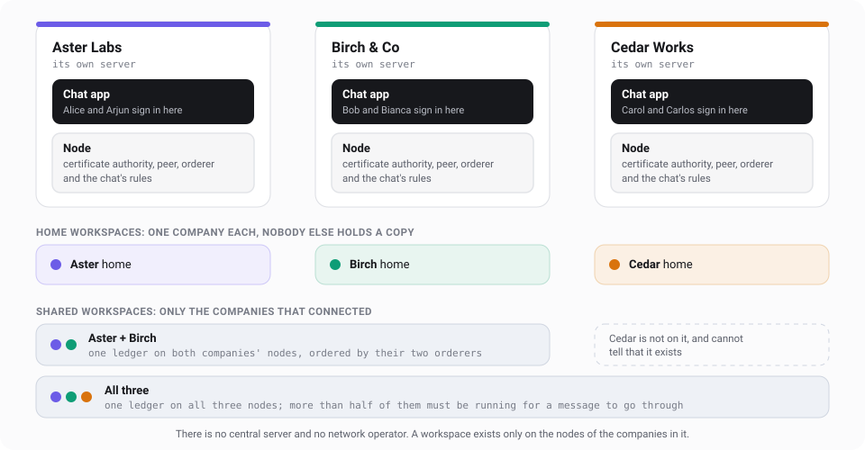
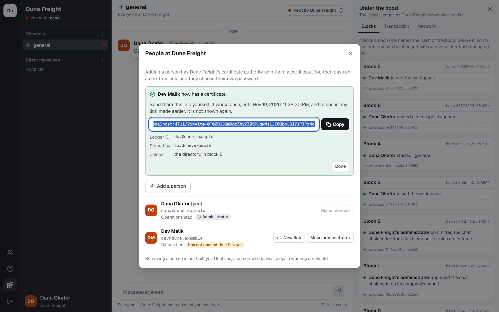
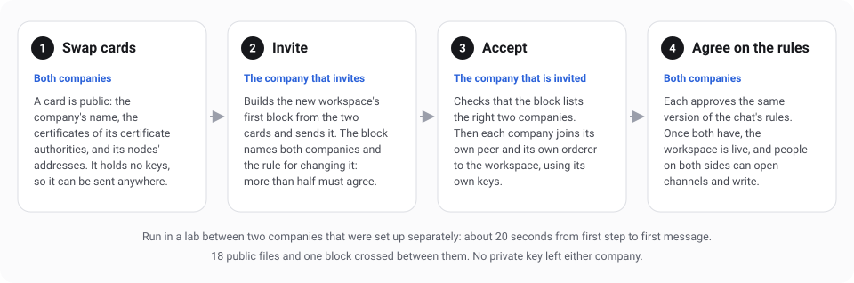
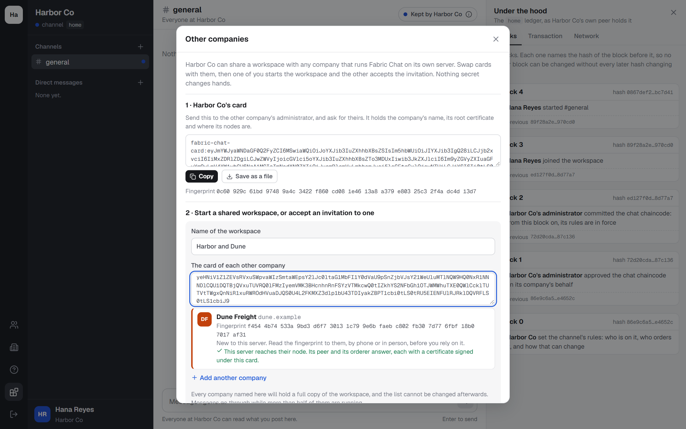
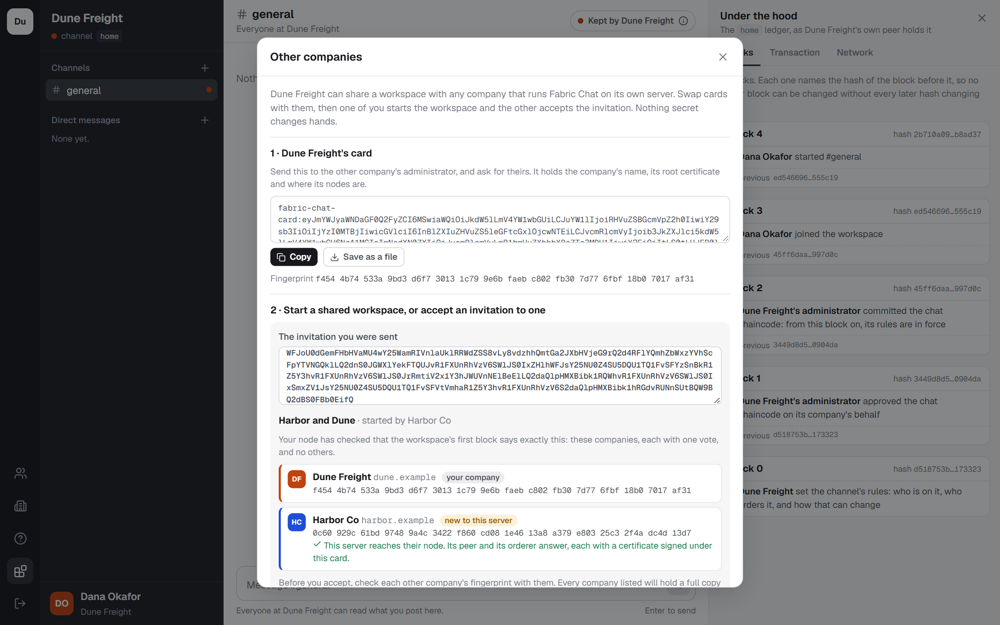
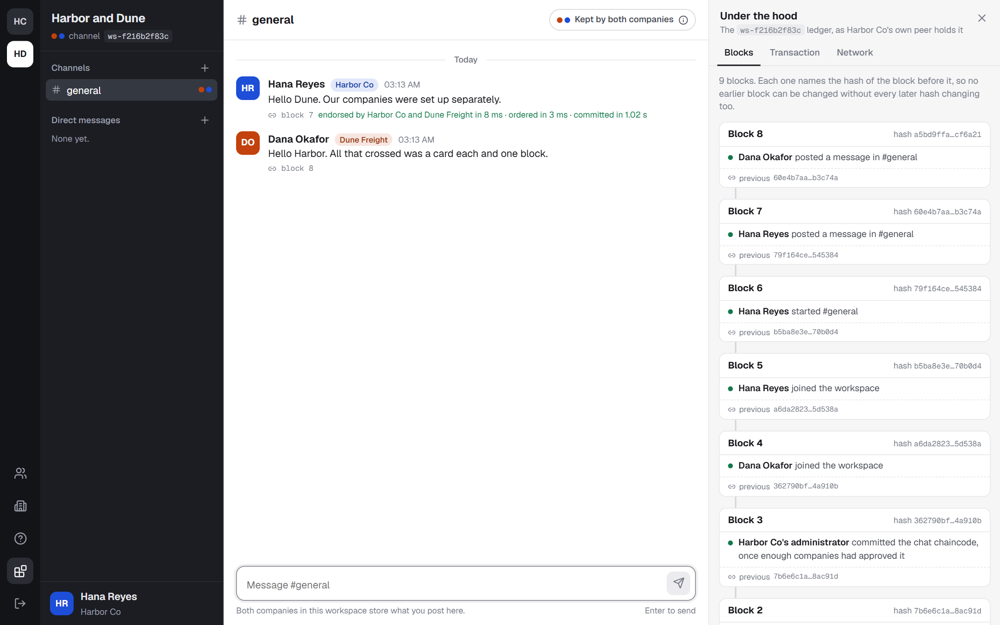
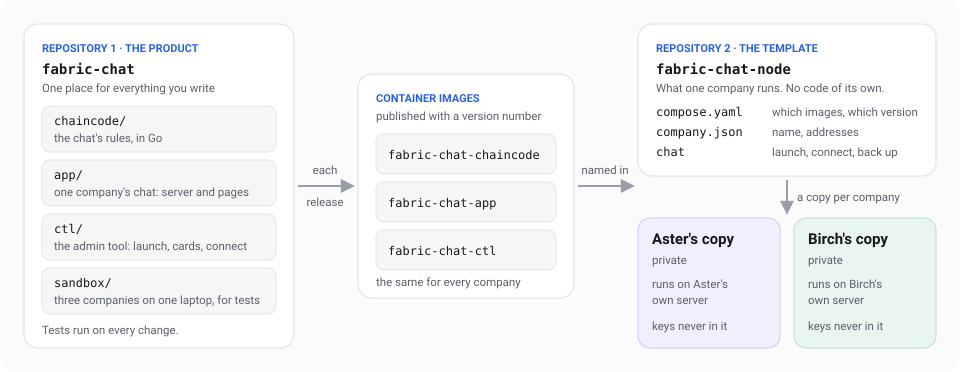

# Fabric Chat for many companies: a simple guide

The sandbox runs three made-up companies on one laptop. This guide is about the real thing: each company runs its own copy on its own server, adds its own people, and connects to other companies when it wants to talk to them.



## The idea

- **Each company runs one small server.** On it are the chat app its people sign in to, and a node: a certificate authority, a peer, an orderer and the chat's rules.
- **A company's own chat is a workspace only it is on.** Nobody else holds a copy, and it works whether or not anyone else's server is running.
- **Talking to another company means sharing a workspace with it.** A shared workspace is one ledger, held by exactly the companies in it. A company that is not in it cannot tell that it exists.
- **There is no central server and nobody to ask for permission.** Two companies connect by swapping public "cards" and agreeing on the same rules.

In Fabric's own words: a company is an organisation, a workspace is a channel, and the rules are chaincode. Fabric 2.5 has no network-wide object to join, only channels, which is why no operator is needed.

## Where it stands

| Step | What it gives | Status |
| --- | --- | --- |
| 1. One company, properly | A company launches on its own server and its people sign in | **Built**, and tested on 12 November 2026 |
| 2. Connect two | Two or more companies share a workspace from inside the app | **Built**, and tested on 13 November 2026, on one machine |
| 3. Two real servers | The same over the internet, with HTTPS and backups | **Built**, and tested on 13 November 2026 on a stand-in for two servers. Not yet run on two real ones |
| 4. Living with it | Removing a person, new versions of the rules, a third company joining | Not started |
| 5. Hardening | Keys off the server, monitoring, an outside review | Not started |

## What was tested for this guide

Each line below was run on 12 or 13 November 2026. The first five were run in a throwaway copy of the project, with the scripts in [lab/](lab/). The next six test step 1 as it is built, the nine after them step 2, and the last ten step 3. Step 3 was tested on a stand-in for the internet, described under the table.

| Claim | What was run | Result |
| --- | --- | --- |
| A company can launch alone | A `network.json` naming one company, Dune Freight, then `npm run net:up` | Up in 15 seconds: its own certificate authority, peer, orderer and rules, a home workspace and two people |
| The sandbox app already works as one company's chat | The app started against that one-company network | Dana created #general and posted; her colleague Dev read it |
| A home workspace needs nobody else | Every other company's peer and orderer stopped | Aster's own workspace kept taking messages. The shared one refused them until the others came back |
| Two companies set up separately can connect | Aster and Dune, each with its own folder, its own keys and its own Docker project | Connected in about 20 seconds. 18 public files and one block crossed between them, and no private key. Alice and Dana read each other's messages, each through their own company's node |
| A two-company workspace needs both companies | Birch's peer stopped, then its orderer | Posts were refused each time and went through again once the node was back |
| A company launches from the template with only Docker | An empty folder holding the template's three files, then `./chat up` | Up in 24 to 30 seconds with the images already on the machine: a root key made there, certificates from the company's own authority, a home workspace, and a one-time link for the first administrator |
| People sign in for real | `npm run test:company`: 86 checks against a throwaway company, over HTTP | All passed. A visitor learns the company's name and nothing else. An administrator adds people, each chooses their own password from a one-time link, and a member cannot do what an administrator can |
| A company's ID can be a domain name | The company `check.example`, with people such as `dana@check.example` | Open and members-only conversations both work. A deleted members-only message is purged from the node |
| The app comes back as it was | The app restarted, then every container removed and started again | People stayed signed in, and every message and account was still there |
| The pages work in a browser | The first administrator and a colleague, walked through in Edge: 39 checks, on a desktop and on a phone | All passed, with no errors in the browser's console |
| The three-company sandbox still works | Its 45 end-to-end checks and the 27 checks of its browser walk, on a copy running the new code, after step 1 and again after step 2. Then each of its three orderers stopped in turn | All passed. With one orderer stopped nothing was refused: the message after the leading orderer stopped took 8 seconds. With two stopped nothing was written |
| Two companies share a workspace through their own apps | `npm run test:companies`: three companies, each launched from the template in a folder of its own, 51 checks | All passed. North started a workspace from South's card, South accepted the invitation, and the workspace was ready at both 8 to 15 seconds later with nobody clicking again. A message in an open channel was endorsed by both companies' peers |
| An invitation that was changed on the way is refused | One with a company's address altered, and one describing the invited company under another certificate | Both refused, and the company joined nothing |
| A company outside a workspace cannot tell it exists | The third company asked its own app about the first two's workspace | Not found. Its node holds no part of it |
| Three companies share a workspace | North started one with South and Third Coast. South accepted first, Third Coast later | Usable 8 to 16 seconds after the second company joined. The third read what was said before it arrived, approved the rules for itself, and all three talked |
| Nothing is refused while an invited company has not answered | The two companies that had joined wrote one message after another, each sent once: 12 in the check, then 24 and 48 in two longer runs | All taken. About one in three went first to the absent company's orderer, which turned it away. The app offered it again and it was written a second or so later. Before that was fixed, a third were refused |
| A shared workspace survives an outage only while more than half remain | South's peer and orderer stopped | The workspace of two refused messages. North's own workspace and the workspace of three carried on. When South returned, the workspace of two took messages again and South had what it missed |
| A workspace of three does not notice one company stopping | The orderer that led the workspace was stopped, and another company wrote at once | All 6 messages taken. The first took 8 seconds, while the two orderers left chose a new leader |
| It says so plainly when too few are left | A second orderer stopped, leaving one of three | One message had already been taken by the last orderer and was never confirmed. The app said that after 30 seconds, and that it might still be written. The next was refused at once. When the orderers returned, a message went through 12 seconds later without being sent again |
| Sharing a workspace by clicking | Two administrators in Edge: copy a card, start a workspace, accept the invitation, talk. 29 checks | All passed. The new workspace appeared for both without reloading the page |
| A release can be published and downloaded | `npm run images -- --push` sent the three images to a registry. Each server held only Docker, the template's two files and a `company.json` | `./chat up` downloaded the images and launched the company in 34 to 39 seconds |
| The chat gets its own HTTPS certificate | Each server asked a certificate authority for one. The authority was Pebble, the test server Let's Encrypt publishes, and it checked each name by calling the server on port 80 or 443 | Issued for both companies. Plain HTTP was sent on to HTTPS, and the sign-in cookie was marked for HTTPS only |
| Only what should be open is open | A machine that belongs to neither company tried the ports of each server | Open: 443, 80, 7051, 7050 and 7055. Closed: the app itself, the certificate authority, the database, and the orderer's admin and status ports |
| A server says truthfully whether it reaches another | Aster's node tried Dune's from a pasted card: as it was, with Dune's orderer stopped, and from a forged card giving Dune's addresses under another root certificate | All three addresses reached and proven. With the orderer stopped, its two addresses were named as silent. With the forged card: something answers, but it is not that company's node |
| Two companies on two servers share a workspace | `npm run test:servers`: 59 checks. Aster started a workspace from Dune's card and Dune accepted | Ready at both 8 to 12 seconds later, across the network. Every message was endorsed by both peers, each on its own server, and both servers ended with the same ledger |
| A server that restarts comes back by itself | Dune's whole server was switched off, then on | Meanwhile the workspace of two refused messages and Aster's own carried on. Dune's chat answered within 2 seconds of its Docker being up, with people still signed in |
| A lost server is replaced from a backup | `./chat backup` on Aster's server. Then the server was destroyed with everything on it, and `./chat restore` run on an empty one at the same names | The backup paused the chat for 28 to 30 seconds. The restore took 22 to 28 seconds. Passwords, the sign-in from before the backup and the HTTPS certificate still worked. What was said in the shared workspace after the backup came back from Dune's server. What was said at home after it was gone |
| A restore is honest about what a company kept to itself | Inside the shared workspace Aster's people had a channel of their own. After the backup one message was written there and one was edited. Then the server was lost and restored | The channel came back as it was at the backup and took new messages. The message that had been edited showed its old words, could no longer be changed, and the app said why. The shared workspace was whole again within seconds |
| A bad restore does no harm | The wrong passphrase, a copy with one byte changed, a copy cut short, and a `company.json` for another company | Each was refused, and the server was left empty |
| Running companies move to a new release | `npm run test:upgrade`: two companies sharing a workspace, started with release 0.2.0's files and images, then given 0.3.0's one after the other. 20 checks | Each moved in 19 to 22 seconds. People stayed signed in and nothing was lost. In between, the two kept talking with one on each release, because the chat's rules were the same in both. The new files with the old release, and the old files with the new one, were each refused in plain words |

**The stand-in for the internet.** Step 3 needs two servers, and one computer was at hand. So each company's server was a container running a Docker of its own, at an address of its own, holding nothing but Docker. Around them ran a name server that knew each company's three names, a registry holding the released images, a certificate authority, and a machine belonging to nobody, to see which ports were open. The two servers shared nothing but that network: each reached the other only by name, and only through a port the other had opened. `scripts/rig.mjs` builds it.

Not run yet:

- Two real servers on different networks. Everything above ran on one computer. Step 3's servers were separate Dockers with separate addresses, which is as near as one computer gets.
- Let's Encrypt itself. The certificates came from its test server, by the same protocol. The real one needs a public name.
- A registry on the internet. The images were sent to, and downloaded from, a registry on the same computer.
- A restore in a workspace of three while the other two carry on writing.
- Adding a company to a shared workspace that already exists. Removing a person.

## What each company runs

| Part | What it is for | Who must be able to reach it |
| --- | --- | --- |
| Chat app | Where the company's people sign in and chat | Only the proxy, once HTTPS is on. Without it, a port of the machine you choose, over plain HTTP |
| Proxy | Answers for the chat over HTTPS, and gets and renews the certificate for its name | The company's people, on ports 443 and 80 |
| Certificate authority | Signs a certificate for each person and each node | Nobody outside the server |
| Peer | Holds the company's copy of each workspace and checks every block | Partner companies' nodes, on port 7051 |
| Orderer | Takes part in putting messages in order | Partner companies' peers, on port 7050, and their orderers, on port 7055 |
| Agent | Joins the company's nodes to a workspace when an administrator shares one. It holds the node administrator's key, so that the chat app does not have to | Nobody. It reaches out to partner companies' peers, to ask them to endorse the rules |
| The chat's rules | The same program at every company | Nobody outside the server |

- **Size.** One company's whole server, app included, used 300 MB of memory when idle. A server with 2 CPUs, 4 GB of memory and 40 GB of disk is plenty to start.
- **Names.** Each company needs three names it controls, for example `chat.aster.example`, `peer.aster.example` and `orderer.aster.example`. The two node names are written into certificates and into every shared workspace, so choose them once. `./chat up` refuses to start if they have changed.
- **Certificates.** The company's root key is made on its own server at the first start, and lasts fifteen years. Its certificate authority signs the nodes and the people under it, for ten years each. Partners trust them because that root certificate is in the company's card. Only the chat needs an ordinary web certificate, and the server gets that one by itself.

## Launch your own

1. Get a machine with Docker.
2. Copy the template folder and fill in `company.json`: the company's name, its ID, its three names and its first administrator.
3. Run `./chat up`.
4. Open the link it prints, and choose a password.

```bash
./chat up
```

The template is the [node-template](../node-template) folder of this repository: `company.json`, the `chat` command and `compose.yaml`. Its [README](../node-template/README.md) is the runbook: every setting, every command, and what is kept in which volume. The same files are published by themselves as the template repository [fabric-chat-node](https://github.com/quirq-ai/fabric-chat-node), where **Use this template** makes a company's own copy.

`./chat up` works in order and checks each step before the next: it makes the root key, starts the certificate authority, has it issue the nodes their certificates, creates the home workspace, deploys the rules, and starts the app. The first run took 24 to 26 seconds. A later run takes about 12 seconds and changes nothing that is already in place. If a step fails, it says which one and why, and starts nothing after it.

As the template comes, the chat answers over plain HTTP on the machine itself and the node is closed to every other server. That is right for a first look. The next section opens it up.

One limit today. `./chat up` downloads the three images from the registry named in `company.json`, but they are not on a public registry yet. Build them from this repository with `npm run images`, and send them to a registry with `npm run images -- --push <name>`.

## Add people



- **An administrator adds a person in the app.** The company's certificate authority signs a certificate for them, and they join the workspace's directory.
- **The person chooses their own password.** The administrator gets a one-time link to pass on. It works once, for seven days. No administrator ever sees a password, and the server keeps only a hash of it.
- **A person's ID reads like an email address:** `alice@aster.example`. The part after the @ is the company's ID, a domain name the company owns, so no two companies can end up with the same one.
- **The first administrator is named in `company.json`.** `./chat up` prints their link. An administrator can make others, and whoever runs the server can let a locked-out administrator back in with `./chat admin-link`.
- **The person's key stays on the company's server**, locked with a key kept in a separate volume. As with company email, this means whoever runs the server could act as any of its people. Keeping keys on people's own devices is a later step.

Still to build: removing a person, and signing in through a company's existing single sign-on.

## Put it on the internet

A server is reachable when three things are true: its names point at it, the right ports are open, and it has a certificate.

1. **Point three names at the server**, with your DNS provider: the chat's, the peer's and the orderer's.
2. **Add two lines to `company.json`** and run `./chat up` again.

```json
  "https": "auto",
  "node": { "address": "0.0.0.0" },
```

| Port | Who reaches it | What answers |
| --- | --- | --- |
| 443 and 80 | The company's people | The chat, over HTTPS. Port 80 only sends browsers on to 443 and lets the certificate authority check the name |
| 7051 | Other companies' servers | The peer |
| 7050 and 7055 | Other companies' servers | The orderer: 7050 for their peers, 7055 for their orderers |

- **The certificate comes by itself.** With `"auto"` the server asks Let's Encrypt for a certificate for the chat's name, proves it answers to that name, and renews it. A company with its own certificate authority names that one in its place.
- **Nothing else is opened.** `./chat up` writes everything the server opens into one file, `compose.generated.yaml`. The certificate authority, the database and the admin ports are never in it.
- **The node's own traffic is encrypted and signed** with certificates from each company's own authority. Anyone can connect to the peer's and the orderer's ports, as with any Fabric network, but a node acts only on a request signed by a member of the workspace concerned.
- **Docker opens ports past a firewall on the same server.** To limit who can reach them, use the firewall your hosting provider puts in front of the server.

The [runbook](../node-template/README.md) has each step in full.

## Talk to another company



An administrator opens **Other companies** in the app.



1. **Swap cards.** Each administrator copies their company's card and sends it to the other, by email or any other way. A card holds the company's name, its ID, its root certificate and where its nodes are. Nothing in it is secret.
2. **One of them starts the workspace.** They give it a name and paste the other's card. Their node builds the new ledger's first block from the two cards, joins it, and hands back an invitation: that block, with both cards.
3. **The other accepts.** Their node first works out for itself what the block should say for those cards, and joins only if the block says exactly that.
4. **The nodes agree on the rules by themselves.** Each company approves the chat's rules for itself, and one of them commits once more than half have. Nobody clicks again. In the tests the workspace was ready 8 to 15 seconds after the accept.



The shared workspace then appears at the left edge of the chat for everyone at both companies, without reloading the page. People open channels and direct messages in it as they do at home.



- **The app says whether your server reaches theirs.** When an administrator pastes a card, and again when they check an invitation, their node tries the other company's peer and orderer. It says if one does not answer. It also says if what answers is not that company's node: the certificate it shows must be signed under the root certificate on the card. Over the internet a closed port is the likeliest thing to be wrong, and without this a workspace would simply never become ready.
- **A fingerprint guards the cards.** A card shows a fingerprint of the company's root certificate. The two administrators read it to each other once, by phone or in person. Without that, someone in between could swap a card for their own.
- **A changed invitation is refused.** Whoever starts a workspace cannot slip in a company, an address or a rule: the other side rebuilds the rules from the cards and compares. In the tests an invitation with one address altered was turned down.
- **Both companies must be online.** In a workspace of two, a message needs both companies' peers to endorse it and both orderers to order it. In a workspace of three or more, it needs more than half: when one company's node stops, the others carry on, and the first message afterwards can take up to ten seconds while their orderers choose a new leader. A partner's outage pauses a workspace of two and nothing else: your home workspace carries on.
- **Nobody can write as another company's people.** Every message is signed with its author's key, and it counts only when another company's peer has checked it too.
- **Each company keeps a full copy** of every open channel and of every conversation its own people are in. Deleting a message blanks it, but cannot take it out of the copy the other company already holds. A conversation among your own people only stays on your node, and the others receive hashes.
- **Three or more companies.** Paste several cards when starting the workspace, and send every company the same invitation. It is usable once more than half have accepted, and a company that accepts later catches up on what was said.

What is not built:

- **Changing who is on a workspace.** The companies are fixed when it is started, and none can leave. Start a new workspace instead.
- **A private store for two companies out of three.** In a workspace of three or more, a conversation among people of two of the companies is kept by all of them, and the app says so before it is created. The sandbox can keep such a conversation between the two, in a store named by joining their IDs with a dash. A domain name may contain a dash, so that name needs a new rule first.

Four traps were found on the way. All four are fixed.

- **Orderers that start at different times.** Two companies' orderers could not reach agreement: the first link between them was made before the second company had joined, without a certificate, and Fabric kept using that link. Each orderer now has a second port, used only between orderers and strict about certificates.
- **A company that joins late.** It can read and write at once, because Fabric quietly passes its requests to the other companies' peers. But until it approves the rules for itself, its own peer endorses nothing, and the workspace cannot survive another company's outage. Each company's node now approves for itself as soon as it joins, and calls the workspace ready only when its own peer can run the rules.
- **An invited company that has not answered.** Its orderer is named in the workspace's rules from the start, so the other companies' peers hand it a share of the messages. It does not know the workspace yet and turns them away, and Fabric's peer then gives up instead of trying another orderer. In a workspace of three, a third of the messages were refused that way. The app now offers a message the orderers did not take to them again, for up to half a minute. That is safe: a message keeps one ID, and a ledger writes an ID once. The same wait covers the seconds a workspace's orderers need to choose a new leader after a company's node stops. The earlier test runs had passed by luck, at two chances in three each time.
- **A minute's wait for something nobody has.** After a restore, a peer meets messages it should hold and does not: the ones its company's people wrote among themselves after the backup. Fabric waits a minute at each for another peer to supply it. No other peer can, because nobody else was ever sent them. With two such messages a shared workspace took 109 seconds to catch up. The template now sets that wait to three seconds, and with six such messages it took 9.

## Back it up

```bash
./chat backup
```

- **One file holds everything**: the ledger, every key, the accounts and the settings. The chat pauses for about half a minute while it is made.
- **The file is locked with a passphrase you choose.** It holds the company's root key, so nobody can open it without the passphrase, you included. Keep the two apart, and keep the file off the server.
- **`./chat restore` brings the company back on an empty server**, with the same `company.json`. It refuses a wrong passphrase, a file that was changed or cut short, and a server that already holds something.
- **A shared workspace heals itself.** What was said in it after the backup comes back from the other companies' servers.
- **What a company kept to itself does not.** That is its own workspace, and any conversation among its own people only, even inside a shared workspace. What was said there after the backup was held by no other server and is gone. A message there that was edited after the backup shows its old words and can no longer be changed: the app says so. Back up as often as you can bear to lose.
- **Restore once, onto one server.** Two servers running as the same company would each sign in its name.

## What had to change in the code

| | In the sandbox | On a company's own server | Status |
| --- | --- | --- | --- |
| Keys | One run makes every company's keys on one machine | Each company makes its own on its own server. Only its card leaves it | Done |
| Node certificates | `cryptogen`, Fabric's test tool | Issued by the company's own certificate authority | Done. The root key is on the server, not yet kept offline (step 5) |
| Settings | `network.json` lists every company and every workspace | `company.json` describes one company | Done |
| Workspaces | Fixed when the network starts | A home workspace at launch. Shared ones by invite and accept | Done. The companies on a shared workspace cannot be changed afterwards |
| Links between orderers | The same port as everything else | A second port that insists on certificates | Done |
| App server | Plays all three companies, with no sign-in, and holds everyone's keys in plain files | One company. Real sign-in. Keys locked on disk. An administrator role | Done, with passwords. Single sign-on is later |
| "Who holds this message" | Asks every company's peer | Asks your own peer. For the other companies it says what Fabric's rules make true, and that their peers were not asked | Done |
| The chat's rules | Built on the spot by `net:up` | A released image. The same version at every company in a workspace | Done. `npm run images -- --push` sends a release to a registry, and `./chat up` downloads it. Not on a public registry yet |
| How people reach the chat | A port of the laptop, over plain HTTP | HTTPS, through a proxy that gets and renews its own certificate | Done. Tested with Let's Encrypt's test server, not with Let's Encrypt itself |
| How nodes reach each other | One Docker network on one machine | By name, through three ports the company opens | Done, on a stand-in for two servers |
| Backups | None. `net:down` removes everything | One locked file, and a restore on an empty server | Done. Mending a message that was edited after the backup needs a change to the chat's rules: step 4 |
| Moving to a new release | Start again | Replace two files, change one line, run `./chat up` | Done, from 0.2.0 to 0.3.0, for a release that leaves the chat's rules as they are. Moving the rules themselves is step 4 |
| Company IDs | `AsterMSP`, letters and digits only | A domain name the company owns | Done |
| A private store for two of three companies | Named by joining the two IDs with a dash | Needs a naming rule that works for domain names | Not built |

The chat's rules barely changed: they now accept a domain name as a company's ID. The sandbox runs the same rules.

## The GitHub repositories

Two, in the end. Add a third only if you need it.



| Repository | What is in it | Who uses it | Today |
| --- | --- | --- | --- |
| `fabric-chat` | The chat's rules, the app, the admin tool, the sandbox and the documents | You, and anyone who wants to read or change the code | Exists, public, under `quirq-ai`. Its images are built and sent to a registry by hand, with `npm run images -- --push` |
| `fabric-chat-node` | A template: `compose.yaml`, `company.json`, the `chat` command and the runbook | Every company. Each makes its own private copy from it | Exists, public, under `quirq-ai`, as a template repository: **Use this template** makes a company's own copy. It is a copy of the `node-template` folder of `fabric-chat`, which stays the source because the tests launch from it: copy the folder across at each release. A company cannot launch from its copy until the images are on a registry it can reach |
| `fabric-chat-directory`, later and only if needed | A public list of company cards | Companies looking for one another | Not needed yet |

Where the folders are today:

| In the plan | Today |
| --- | --- |
| `fabric-chat/chaincode` | `chaincode/chat` |
| `fabric-chat/app` | `server`, `web` and the `Dockerfile` at the top |
| `fabric-chat/ctl` | `ctl`: the admin tool a company's server runs at each start |
| `fabric-chat/sandbox` | `network` and `network.json`: the three-company sandbox |
| `fabric-chat-node` | `node-template`, copied to the `fabric-chat-node` repository at each release |
| The `connect` commands of `ctl` | `ctl/workspaces.sh` and `ctl/agent.sh`. `docs/lab` keeps the first experiment |

- **How a release will reach a server.** A version tag on `fabric-chat` makes GitHub Actions run the tests, build the three images, publish them to GitHub's container registry and copy the template to `fabric-chat-node`. A company replaces its `chat` and `compose.yaml` with that version's, changes `release` in its `company.json`, and runs `./chat up` again. Its server only ever downloads images. The download and the move to a new release are built and tested. The GitHub Actions and the public registry are not set up yet: today the images are sent, and the template copied, by hand.
- **Why not one repository.** A company should not have to read or build source code to run its node. Its copy of the template holds only its settings, so it stays small and rarely changes.
- **Why not more.** The rules, the app and the tool still change together, and one repository lets one change cover all three. Split the rules into their own repository on the day another company wants to review rule changes on its own.
- **What never goes into any repository.** Private keys, passwords, and the `.env` file `./chat up` writes. On a company's server none of the first two is ever written into the folder at all: they stay in Docker volumes.

## Build order

| Step | What gets built | Done when | Status |
| --- | --- | --- | --- |
| 1. One company, properly | `company.json`, `chat up`, the app for one company with real sign-in, the home workspace | A new company on a clean machine is chatting among its own people within ten minutes | Built. From an empty folder to the first administrator's link took 24 to 26 seconds, on the machine the images were built on. Not yet tried on a second machine |
| 2. Connect two | Cards, invite and accept as buttons in the app. Three companies that were each set up separately share workspaces | The lab's result, reached by clicking rather than by script | Built, on one machine. `npm run test:companies` launches three separate companies and connects them. The teaching sandbox is still the older three-in-one network |
| 3. Two real servers | Published images, the node's ports opened, real names, HTTPS, firewall rules, backups | Two companies on different networks exchange messages over the internet | Built, and proven on a stand-in: two Dockers with their own addresses on one computer, 59 checks in `npm run test:servers`. The last step is yours to give: two real servers, three names for each, and a registry both can reach |
| 4. Living with it | Removing a person, moving every company to a new version of the rules, adding a company to an existing workspace | Each has been done once, start to finish, in the sandbox | |
| 5. Hardening | Keys in a hardware module or on people's devices, the certificate authority's key offline, monitoring | Someone outside the team has reviewed it | |

## Decisions

Steps 1 to 3 took the recommended answer to six of these. Three are still open.

1. **Company IDs: a domain name the company owns.** Decided, and built.
2. **How people sign in: passwords for now.** Each person chooses their own from a one-time link. The company's existing single sign-on can come later.
3. **Where it runs: Docker Compose on one server per company.** Decided, and built. Kubernetes can wait.
4. **A name, a licence, and whether the code is public.** The code is public: both repositories have been since November 2026. Public code lets another company see exactly what it is being asked to run. The licence is MIT: anyone may use, change and pass on the code, as long as the copyright notice stays with it. The name is still open.
5. **Who can join a shared workspace: the companies named when it is started, and no changes afterwards.** Decided, and built. Adding or removing a company later is step 4.
6. **HTTPS: a proxy on the same server that gets its certificate from Let's Encrypt.** Decided, and built. One line in `company.json` and no certificate to buy or renew by hand.
7. **Backups: one file, locked with a passphrase, made by hand or on a schedule.** Decided, and built. Sending it off the server is left to the company.
8. **Where the images are published.** Still open. GitHub's container registry under `quirq-ai` is the obvious place. Public images let any company download them without an account. Private ones need each company to sign in.
9. **Who may reach a node's ports: anyone, or only known partners.** Still open. Today they are open to anyone and guarded by certificates and signatures, as Fabric intends. A company that wants more limits them at its provider's firewall, to the addresses of the companies it shares a workspace with.
